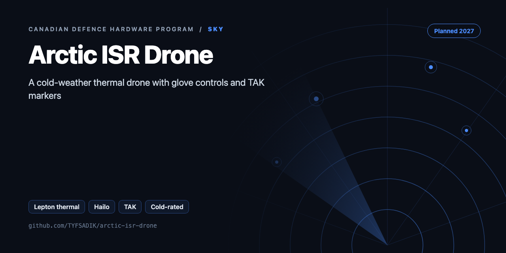
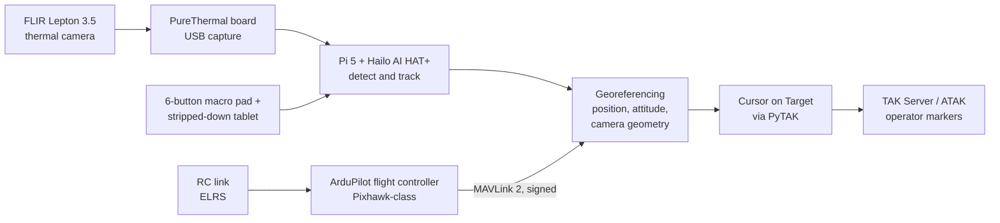

<div align="center">



# Arctic ISR Drone (Cold, Glove-Operable, Thermal, TAK)

**Build guide for a cold-weather Arctic ISR drone: Lepton thermal detection on a Hailo accelerator, georeferenced TAK markers, glove controls, honest spec gaps.**

[](https://github.com/TYFSADIK/arctic-isr-drone/actions/workflows/tests.yml)   [](LICENSE) [](https://github.com/TYFSADIK/defence-hardware-program)

[Build guide](docs/project-page.md) · [How it works](#how-it-works) · [Quick start](#quick-start) · [Program hub](https://github.com/TYFSADIK/defence-hardware-program)

</div>

## Overview

This is a published build guide for a hobby-scale Arctic ISR drone planned against the Government of Canada MINERVA Arctic UAS specification: a quadcopter that finds people and vehicles with a thermal camera, runs detection on board, pushes georeferenced markers into TAK, and stays operable with winter gloves. Nothing on this page is built or tested yet.

Canada publishes its defence needs as measurable specs, and the MINERVA Arctic UAS challenge is one of the clearest: a small uncrewed aircraft that operates from -40 to +40 C, holds station in 55 km/h wind, covers a 20 km radius for 90 minutes, and can be worked by an operator wearing winter gloves. Proposals for that challenge closed on September 24, 2026, and a solo hobby builder was never going to bid. The spec still makes an excellent engineering target, so this guide treats it as a spec sheet and builds the parts a bench-scale project can honestly demonstrate.

Scope honesty is the design rule. A bench build cannot meet a 25 kg takeoff weight with a 20 km radius and 90 minute endurance, and this page never claims otherwise. What it can do is prove the hard subsystems in miniature: a heated and instrumented battery bay with real cold-soak data, thermal person and vehicle detection with a measured pixel-size limit, detections georeferenced into TAK markers, and a glove-operable control kit with timed tasks. Every subsystem ends in a spec-gap table that states plainly what was met, what was partial, and what was never tested.

## How it works



*Thermal frames are captured over USB, inference runs on the Hailo accelerator, detections fuse with signed MAVLink telemetry into coordinates, and Cursor on Target messages carry the markers to TAK, while the operator flies by RC link and works the payload with a physical macro pad.*

## Quick start

```bash
pip install -r requirements.txt
python demo.py && python -m unittest -v
```

Real output from the demo, run on simulated data:

```text
| Target | Task | Spec range (m) | Hobby build (m) | Gap |
|---|---|---|---|---|
| person | detect | 500 | 54 | -89% |
| person | recognise | 150 | 13 | -91% |
| vehicle | detect | 1500 | 247 | -84% |
  20 C: 18.8 min unheated, 18.8 min heated
 -10 C: 11.4 min unheated, 17.5 min heated
 -30 C: 6.6 min unheated, 17.5 min heated
hotspot -> 69.117122,-105.059658  GSD 0.68 m/px
<?xml version="1.0" encoding="UTF-8"?><event version="2.0" uid="det-4aeaf16b-3276-4e1a-b22f-d3f6d181 ...
```

## What's in this repo

| File | Purpose |
|---|---|
| `isr/thermal.py` | Radiometric hotspot detector and synthetic Arctic frames |
| `isr/georef.py` | Near-nadir georeferencing and error budget |
| `isr/cot.py` | CoT markers for ATAK |
| `isr/spec_gap.py` | Johnson-criteria detection, recognition, and identification ranges, rendered as a markdown spec-gap table |
| `isr/cold_ops.py` | Flight time vs temperature (placeholder curve) and glove UI layout checks |

## What you need

| Item | Role in the build |
|----|----|
| Pixhawk-class flight controller with GPS (RTK later) | ArduPilot brain; RTK added when georeference truth needs tightening |
| X500-class frame, motors, ESCs | Airframe for Phases 3 and 4 |
| Raspberry Pi 5 (8 GB) | Companion computer for capture, georeferencing and PyTAK |
| AI HAT+ (Hailo) | On-board detection accelerator |
| FLIR Lepton 3.5 + PureThermal board | Thermal sensing over USB |
| Visible camera | Daytime comparison against thermal |
| 6S 21700 Li-ion pack or LiPo | Flight battery; the cold rig is built around it |
| Heater film, DS18B20 thermistors, INA228 power monitor | Heated, instrumented battery bay |
| ELRS RC link | Manual flight control |
| USB macro pad | Glove-operable payload controls |
| Balance charger + fire-safe bag | Battery discipline on the bench |

## Spec gaps

How the hobby build compares with the requirement it is built against:

| Requirement | MINERVA target | Hobby status |
|----|----|----|
| Operating temperature | -40 to +40 C | Partial: freezer at about -18 C plus real winter; only tested temperatures reported |
| Wind | 55 km/h | Not met: an X500-class quad will not hold position in 55 km/h wind; real wind logged |
| Precipitation | Light rain, snow, moderate icing | Partial: no icing test planned |
| Radius | 20 km | Not tested: visual line of sight only |
| Endurance | 90 minutes | Partial: different airframe class |
| Takeoff weight | 25 kg | Not comparable: hobby airframe is far lighter |
| Transport | 240 L container | Measure and report |
| Glove operation | Operable with winter gloves | To be tested with timed tasks |
| TAK compatibility | TAK output | To be tested: Cursor on Target via PyTAK |
| VTOL | Desired extra | Yes, but not the spec airframe |
| Fibre-optic mode | Desired extra | Not tested |
| Production cost | About \$60,000 or less | Argued only via BOM plus scaling argument |
| Recognition | People and vehicles, day and night | Partial: wording cited to a secondary source (verify) |

## What gets measured

- Detection recall and false alarms per pixels-on-target, split day and night.
- Georeference error against surveyed marks.
- Image-to-TAK latency, frame capture to marker on screen.
- Endurance and voltage sag versus temperature.
- Heater watt-hours per flight.
- Glove task times: launch, abort, mark, with error counts against bare hands.
- Bill of materials cost with the scaling argument toward the spec target.

## Related builds

- [Thermal Search-and-Rescue Drone](https://github.com/TYFSADIK/thermal-sar-drone): the sister build that pairs a Lepton thermal camera with a Hailo accelerator for person detection, the closest reference for this pipeline.
- [GPS-Denied Navigation Rover](https://github.com/TYFSADIK/gps-denied-navigation-rover): ground-vehicle navigation work that shares the surveyed-truth approach to measuring position error.
- [Secure Fleet Updates](https://github.com/TYFSADIK/secure-fleet-updates): signed, measured update flows for robot fleets, relevant to the MAVLink 2 signing and key handling on this airframe.
- [Counter-Drone Sensor Fusion](https://github.com/TYFSADIK/counter-drone-sensor-fusion): the receiving end of detections, where TAK integration and scoring discipline get exercised at fleet scale.
- [Defence Hardware Program](https://github.com/TYFSADIK/defence-hardware-program): the parent program page tying all six builds to the Canadian government specs they target.

## Learn more

The full build guide, with step-by-step instructions, wiring, troubleshooting and lessons learned, is in [docs/project-page.md](docs/project-page.md). It is also published at [tyfsadik.org](https://tyfsadik.org/work/defence/arctic-isr-drone.html).

## License

[MIT](LICENSE). Built by [Taki Sadik](https://tyfsadik.org) as part of the self-funded [Canadian Defence Hardware Program](https://github.com/TYFSADIK/defence-hardware-program).
